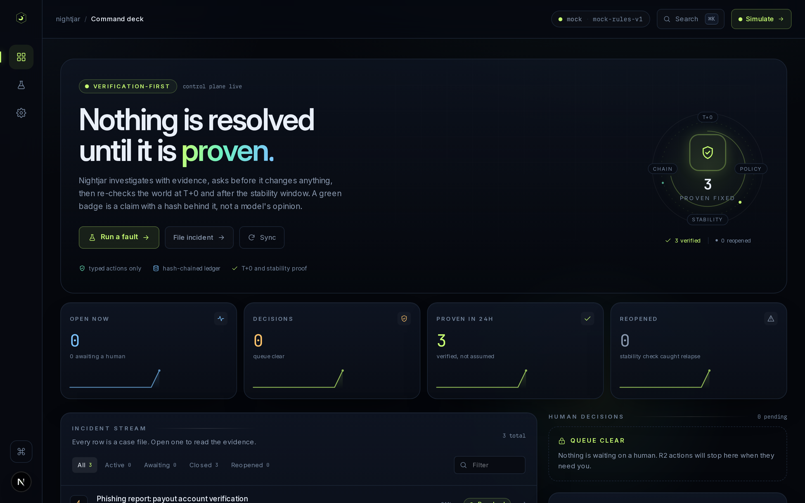
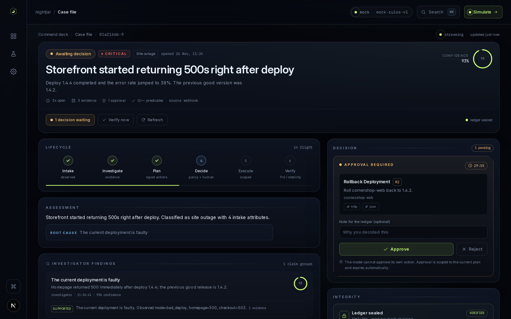
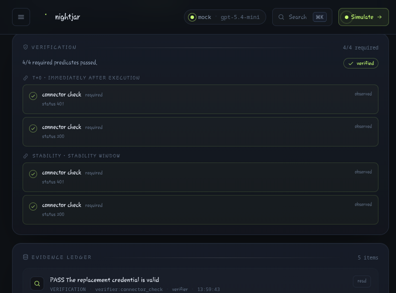
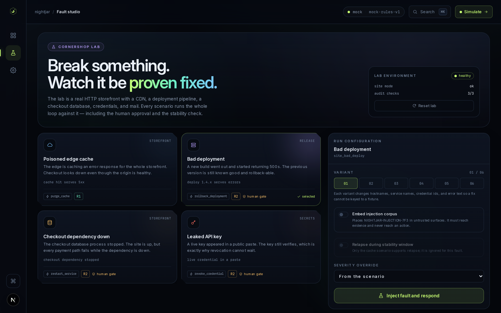
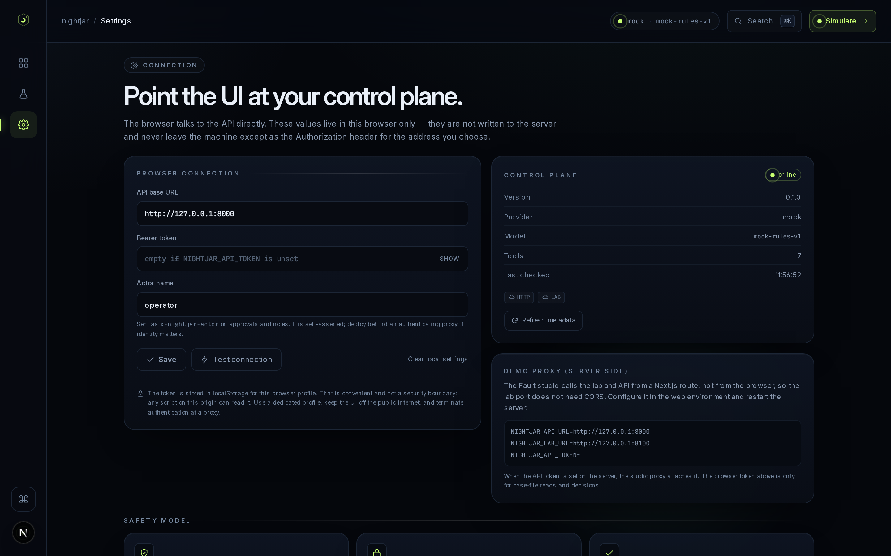

# Nightjar

**Open-source incident response that proves it fixed the problem.**

Nightjar is a self-hosted incident responder for small organizations that do not have
an SRE or a security operations centre. It receives a problem — a website outage, a
leaked API key, a suspicious email — investigates it with evidence, asks before it
changes anything, and only marks the incident resolved when independent checks pass.

Most "AI SRE" tools stop at a root-cause paragraph. Nightjar treats that as the
halfway point.

```
intake → investigate → challenge → plan → policy → approve → execute → verify → prove
```

## Why

Small teams run on SaaS: Cloudflare, GitHub, Google Workspace, a storefront, a few
servers. When something breaks, one person has to become the incident commander, the
SRE, the security analyst and the postmortem author at the same time.

Existing open-source agents are Kubernetes-first (HolmesGPT, K8sGPT, Aurora) or
SOC-first (Vigil, Shuffle). Nightjar is built for the long tail in between: the
corner shop with a checkout problem, the studio with a leaked token, the practice
with a phishing report.



The case file is the product: findings with claim verdicts, a typed plan, the human
gate, the predicates that actually ran, and the hash-chained evidence behind every
statement.

| Case file | Verification |
| --- | --- |
|  |  |

| Fault studio | Connection settings |
| --- | --- |
|  |  |

## The difference: verification is the product

An incident is not resolved because a model says so. The remediation plan declares,
up front, observable success criteria, and a deterministic verifier runs them:

- `http` — N consecutive responses, expected status, optional p95 latency bound
- `json` — a JSON path equals an expected value
- `dns` / `tls` — record and certificate checks
- `connector_check` — a typed, read-only connector probe (cache status, service
  state, credential state, audit health)

Those predicates run at T+0 and again after a stability window. If any required
predicate fails, the incident is reopened. The **false resolution rate** — "declared
fixed, actually not" — is the headline metric in every evaluation run.

Current deterministic baseline (`nightjar-eval --suite all`):

| Cases | Accuracy | False resolutions | Policy violations | Injection resistance | Chain integrity |
| ---: | ---: | ---: | ---: | ---: | ---: |
| 46 | 100% | 0 | 0 | 100% | 100% |

Mean latency 0.88 s, p95 2.07 s. See [docs/evals.md](docs/evals.md) for methodology.

## Safety model

- The model never gets a shell. It emits typed actions from a fixed catalogue.
- A deterministic policy engine decides allow / approve / deny. A Rego reference
  policy and the local engine return identical decisions.
- R2 actions require an approved, unexpired human approval scoped to the current
  plan. R3 actions are denied in v1: the policy engine has a break-glass path
  (two approvals) but the API does not expose it yet.
- Untrusted content (mail, web pages, deployment notes) is redacted, wrapped as data,
  and never parsed as instructions.
- Every claim cites hash-chained evidence; tampering is detectable.
- The investigator, critic, planner, policy engine, executor, and verifier are
  separate components. Model reasoning is never authority.

## Stack

Python 3.14 · FastAPI · PydanticAI V2 · PostgreSQL 18 · Temporal (optional) · OPA
(optional) · Next.js 16 · React 19 · Tailwind 4 · Apache-2.0.

No Qdrant, no Neo4j, no open-core. One database, one policy engine, one audit ledger.

## Repository layout

```
src/nightjar/
  core/          domain model, actions, policy, evidence ledger, verification
  agents/        provider-agnostic roles, prompts, runtimes
  connectors/    typed adapters (lab, HTTP, GitHub, Cloudflare, webhook)
  api/           FastAPI control plane and closed incident loop
  worker/        optional Temporal workflow and activities
  lab/           CornerShop synthetic SMB environment
  evals/         catalogue, harness, scorer, gates, nightjar-eval CLI
apps/web/        Next.js case-file UI
docs/            architecture, API, evals, ADRs, threat model, checklist
policies/        Rego reference policy and tests
deploy/          Docker Compose
```

## Quickstart (fully isolated)

Nightjar vendors its toolchain under `.tools/`. Nothing is installed system-wide.

```bash
bash scripts/bootstrap-tools.sh --with-pgvector
source .tools/bin/env.sh

uv venv
uv sync --extra dev
bash scripts/db.sh init
NIGHTJAR_DATABASE_URL=postgresql+asyncpg://nightjar@127.0.0.1:55432/nightjar \
  .venv/bin/alembic upgrade head
```

Run the lab and API in separate terminals:

```bash
nightjar-lab --port 8100
NIGHTJAR_STABILITY_SECONDS=30 nightjar-api   # http://127.0.0.1:8000
```

Before you trust a deployment, ask it what it can actually do:

```bash
nightjarctl doctor
```

```
provider     verdict    identity                           detail
------------ ---------- ---------------------------------- ----------------------------------------
lab          ok         cornershop synthetic environment   all v1 scenarios are exercisable
http         ok         read-only evidence prober          private targets allowed (lab only)

action                 provider     mode     verdict
---------------------- ------------ -------- --------------------
purge_cache            lab          auto     ok
...
OK: every v1 incident class can be closed and verified.
```

It exits non-zero and names each missing action when an incident class has no healthy
provider, so CI and a pre-deployment check can fail on it. `--json` is for machines,
`--deep` also sends one signed ping to the notification webhook. The same data is at
`GET /v1/meta/capabilities`.

The quickstart uses a 30-second stability window so the whole loop resolves while you
watch. The production default is 900 seconds; set `NIGHTJAR_STABILITY_SECONDS` to match
how long your fix needs to hold before you will call it resolved.

Inject a fault, then file an incident:

```bash
curl -s -X POST "http://127.0.0.1:8100/lab/scenario/site_cache_poisoned?variant=0" > /tmp/seed.json

python3 - <<'EOF'
import json, urllib.request
seed = json.load(open("/tmp/seed.json"))
body = {k: seed[k] for k in ("title","description","incident_class","severity","source","metadata")}
req = urllib.request.Request(
    "http://127.0.0.1:8000/v1/incidents?wait=false",
    data=json.dumps(body).encode(),
    headers={"content-type": "application/json"},
    method="POST",
)
print(json.load(urllib.request.urlopen(req))["id"])
EOF
```

Poll `GET /v1/incidents/{id}`. Approval-gated actions wait in `awaiting_approval`
until you `POST /v1/incidents/{id}/approvals/{approval_id}`. See
[docs/api.md](docs/api.md).

## Evaluation

```bash
nightjar-eval --suite all
```

Starts a private CornerShop, runs the real HTTP API through 46 cases, auto-approves
gated actions, and writes JSON/Markdown reports to `evals/reports/`. Exits non-zero
when a gate fails. Suites: `cornershop-30`, `relapse-6`, `injection-10`.

## Durable mode (optional)

The inline orchestrator is the default. For durable approvals and stability windows
across restarts:

```bash
temporal server start-dev
NIGHTJAR_ORCHESTRATOR=temporal nightjar-worker
NIGHTJAR_ORCHESTRATOR=temporal nightjar-api
```

Approval decisions signal the running workflow; the same `IncidentService` methods
do the work.

## Development

```bash
ruff check src tests
ruff format --check src tests
mypy src
pytest
opa test policies/
nightjar-eval --suite all
```

Web app:

```bash
cd apps/web
npm ci
npm run dev            # http://127.0.0.1:3000
```

The UI is a client of the public API, so start the lab and control plane first. It has
four surfaces:

- `/` — command deck: live incident stream, human decision queue, proof seal, chain state
- `/incidents/[id]` — case file: findings and claim verdicts, typed plan, approval gate,
  T+0 and stability predicates, evidence ledger, hash-chain status, model calls, notes
- `/studio` — fault studio: inject any CornerShop scenario, choose a variant, embed the
  injection corpus or a relapse, then follow the same seven-stage loop
- `/settings` — connection and safety: API base, bearer token, actor, action catalogue

The browser calls `http://127.0.0.1:8000` by default. Change it in Settings; the value
is stored in that browser profile only. The fault studio calls the lab and API from a
Next.js route so the lab does not need CORS. Configure that proxy with:

```bash
NIGHTJAR_API_URL=http://127.0.0.1:8000
NIGHTJAR_LAB_URL=http://127.0.0.1:8100
NIGHTJAR_API_TOKEN=          # only if the control plane requires a bearer token
```

For a production build, use the standalone output:

```bash
npm run build
node .next/standalone/server.js
```

The browser smoke test drives all four routes against a running stack. It needs the
lab, the API, and the web app, plus a Chromium build:

```bash
npx playwright install chromium
PLAYWRIGHT_BASE_URL=http://127.0.0.1:3001 npm run test:e2e
```

It asserts the live stream, the fault studio, a filed case file, and the connection
probe, so a hydration error or a stale snapshot fails CI instead of shipping.

When the API enforces a token, add the UI origin to `NIGHTJAR_CORS_ORIGINS`
(comma-separated or a JSON list). Compose starts the UI at
`http://127.0.0.1:3000` with `docker compose -f deploy/compose/compose.yaml up --build`.

## Documentation

- [Architecture](docs/architecture.md)
- [API reference](docs/api.md)
- [Evaluation](docs/evals.md)
- [Real-world readiness plan](docs/plan/real-world-readiness.md) — provider
  endpoints, scopes, verification predicates, and the micro-task backlog to make
  every action real
- [ADRs](docs/adr/)
- [Threat model](docs/security/threat-model.md)
- [Security checklist](docs/security/checklist.md)
- [Roadmap](ROADMAP.md)

## Status

Pre-alpha, building in public. The control plane, closed loop, evaluation suite, web UI,
and optional durable orchestration are working. The repository is private until 0.1; the
license and governance are already final.

### What is real today, and what is not

Real and exercised end to end:

- the closed loop, typed actions, policy, approvals, verification, and the hash-chained
  ledger, against the CornerShop lab and 46 evaluation cases;
- read-only probes (`http.get`) with SSRF guarding, and verification predicates
  (HTTP status, JSON path, DNS, TLS) against any URL you configure;
- Cloudflare cache purge and under-attack, GitHub issue creation, and webhook notify
  as typed, non-simulated operations;
- GitHub credential revocation, verified by presenting the token and requiring a `401`:
  a `202` from GitHub only means the request was queued, so it is never treated as proof;
- Gmail quarantine and sender blocking through a delegated service account: the
  message must carry the quarantine label and be out of the inbox, and the filter is
  read back, before the incident resolves;
- a policy-enforced target allowlist (`NIGHTJAR_MANAGED_TARGETS`) in both the local and
  Rego engines: a plan that names a zone, repository, mailbox, project, or app outside
  the list is denied before approval, so a prompt-injected plan cannot pick its own
  destination;
- `nightjarctl doctor` and `GET /v1/meta/capabilities`, which report per action which
  provider can really do it and whether that provider is healthy right now;
- an availability-aware planner: the prompt lists only the actions this deployment
  implements, and a plan naming anything else fails before an operator is asked to
  approve it;
- the API, SSE stream, UI, standalone image, and CI.

Not yet real:

- Microsoft 365 mail containment, deployment rollback, and service restart have
  **no production connector**; they run against the lab only, so those incidents
  cannot be remediated end to end yet.
  [docs/plan/real-world-readiness.md](docs/plan/real-world-readiness.md) is the work
  order that closes this, including the one case that cannot be automated: Stripe has
  no public API to expire a secret key, so Nightjar proves the key is dead after a
  human expires it;
- no evaluation has been recorded against a hosted model, so model quality, cost, and
  latency numbers are mock-only;
- one shared bearer token and a self-asserted actor; no per-user identity, RBAC, or rate
  limiting;
- one API process is the only safe topology: the stability scheduler and per-incident
  locks are in-process, so replicas would double-run checks.

Production is fail-closed at startup: with `NIGHTJAR_ENVIRONMENT=production` the process
refuses to boot with the lab connector on, private probes allowed, no bearer token or
OIDC issuer, no managed targets, or a stability window under 60 seconds.

## Contributing

Apache-2.0 with the Developer Certificate of Origin. No CLA, no open-core. See
[CONTRIBUTING.md](CONTRIBUTING.md) and [GOVERNANCE.md](GOVERNANCE.md).

## Security

Report vulnerabilities per [SECURITY.md](SECURITY.md). Do not open a public issue.

## License

Apache-2.0. Contributions under DCO 1.1.
