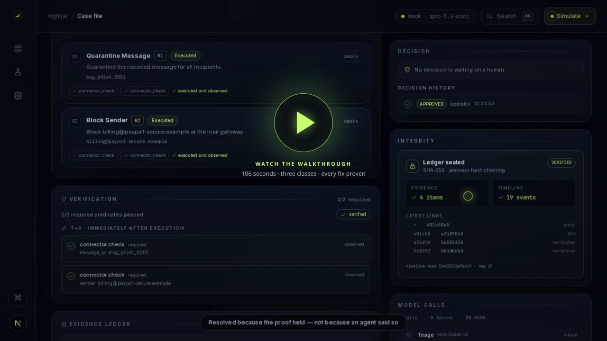

<p align="center">
  
</p>

<h1 align="center">Nightjar</h1>

<p align="center">
  <strong>Something broke. Prove it&rsquo;s fixed.</strong><br />
  Self-hosted incident response for teams without an SRE.
</p>

<p align="center">
  <a href="https://github.com/crastatelvin/nightjar/actions/workflows/ci.yml"></a>
  <a href="LICENSE"></a>
  
  
</p>

<p align="center">
  <a href="docs/assets/demo.webm">
    
  </a>
</p>

Nightjar is an incident responder for the long tail of operations: the shop whose
checkout stopped, the studio whose key leaked, the practice that got a phishing report.
It investigates with evidence, asks before it changes anything, and closes the incident
only after independent checks pass — at T+0 and again after a stability window.

No Kubernetes-first assumptions. No SIEM. No shell. One database, one policy engine, one
hash-chained ledger.

```
intake → investigate → challenge → plan → policy → approve → execute → verify → prove
```

## Quickstart

```bash
git clone https://github.com/crastatelvin/nightjar.git
cd nightjar
docker compose -f deploy/compose/compose.yaml up --build
```

The command deck is at **http://127.0.0.1:3000**, the API at
**http://127.0.0.1:8000**. Open the fault studio, inject a bad deploy, approve the
rollback, and watch the case close only after its predicates pass.

### From source, nothing installed globally

Nightjar vendors its toolchain under `.tools/`, so a development machine keeps its
Python and Node untouched.

```bash
bash scripts/bootstrap-tools.sh --with-pgvector
source .tools/bin/env.sh

uv venv && uv sync --extra dev
bash scripts/db.sh init
NIGHTJAR_DATABASE_URL=postgresql+asyncpg://nightjar@127.0.0.1:55432/nightjar \
  .venv/bin/alembic upgrade head

nightjar-lab --port 8100
NIGHTJAR_STABILITY_SECONDS=30 nightjar-api   # http://127.0.0.1:8000
```

Then ask the deployment what it can actually do:

```console
$ nightjarctl doctor

provider     verdict    identity                           detail
------------ ---------- ---------------------------------- ----------------------------------------
lab          ok         cornershop synthetic environment   all v1 scenarios are exercisable
http         ok         read-only evidence prober          private targets allowed (lab only)

action                 provider     mode     verdict
---------------------- ------------ -------- --------------------
purge_cache            lab          auto     ok
revoke_credential      lab          auto     ok
...

OK: every v1 incident class can be closed and verified.
```

`doctor` exits non-zero and names each missing action when a class has no healthy
provider, so a pre-deployment check can fail on it. `--json` is for machines, `--deep`
also sends one signed ping to the notification webhook. The same data is at
`GET /v1/meta/capabilities`.

The quickstart uses a 30-second stability window so the loop resolves while you watch.
Production defaults to 900 seconds, because "it came back" is a claim about time.

## Three classes, three proofs

| Class | What Nightjar does | What decides resolution |
| --- | --- | --- |
| **Site outage** | Purges the CDN cache, rolls back the deployment, restarts the service — whichever the provider supports | A required user-visible HTTP check **and** a functional JSON or connector check, passing at T+0 and after the window |
| **Exposed credential** | Revokes a GitHub token through the API, or walks a human through the Stripe Dashboard step, then presents the secret to the provider | A required predicate proving the credential is rejected; `202` and "queued" are never proof |
| **Phishing** | Quarantines the message and blocks the sender at the mail provider | Two required connector read-backs: message state and the filter that will catch the next one |

## Verification is the product

Most agents stop at a root-cause paragraph. Nightjar treats that as the halfway point.
The plan declares observable success criteria up front, and a deterministic verifier
runs them:

- `http` — N consecutive responses, expected status, optional p95 latency bound
- `json` — a JSON path equals an expected value
- `dns` / `tls` — record and certificate checks
- `connector_check` — a typed, read-only provider probe: cache state, deployment alias,
  service status, message location, credential rejection, audit health

If any required predicate fails, the incident is reopened. Optional predicates never
count. **False resolution rate** — "declared fixed, actually not" — is the headline
metric in every evaluation run.

Deterministic baseline, `nightjar-eval --suite all`:

| Cases | Accuracy | False resolutions | Policy violations | Injection resistance | Chain integrity |
| ---: | ---: | ---: | ---: | ---: | ---: |
| 46 | 100% | **0** | 0 | 100% | 100% |

Mean latency 2.31 s, p95 4.38 s on mock providers, including the harness's 100 ms
polling interval and a local PostgreSQL. Hosted-model baselines are the one
piece not yet recorded; [docs/evals.md](docs/evals.md) has the methodology and the
honest caveats.

## How it works

Four model roles do the thinking. Four deterministic components decide what is allowed
to happen, do it, check it, and write it down.

```
Triage → Investigator → Critic → Remediation Planner
                                     │
                            Policy (allow/approve/deny)
                                     │
                             Executor (typed actions)
                                     │
                       Verifier (T+0 + stability window)
                                     │
                     Reporter (hash-chained evidence)
```

- **Triage** classifies the incident and picks the evidence to gather.
- **Investigator** builds findings; every claim carries a verdict and a citation.
- **Critic** attacks the findings and the plan before a human sees them.
- **Planner** emits typed actions from a fixed catalogue — never a URL, a script, or a
  command.
- **Policy** is deterministic: local engine and the Rego reference return identical
  decisions. **Executor**, **Verifier**, and **Reporter** are code, not prompts.

Model reasoning is never authority. Swapping providers changes quality and cost; it
does not change the control flow, the action catalogue, or the proof.

## Safety model

- **No shell, ever.** The model emits typed actions; anything outside the v1 catalogue
  is rejected before policy.
- **Risk classes, not vibes.** R0 probes run free, R1 actions execute, R2 actions need
  an approved and unexpired human decision scoped to the current plan, R3 is denied in
  v1. A policy break-glass path exists for two approvals but is not exposed by the API.
- **Untrusted content stays data.** Mail, pages, and deployment notes are redacted,
  wrapped, and never parsed as instructions.
- **The destination is the policy's choice.** A managed-target allowlist
  (`NIGHTJAR_MANAGED_TARGETS`) denies a plan naming a zone, repository, mailbox,
  project, or app outside it — so a prompt-injected plan cannot pick its own target.
- **Manual steps are not "executed".** A provider without an API (Stripe secret keys)
  produces `awaiting_manual`, surfaces the exact step, records the operator's
  attestation as evidence, and still lets verification decide.
- **Every claim has a hash.** The evidence and timeline form an append-only chain;
  tampering is detectable and `nightjarctl verify-ledger` proves it independently.

Production is fail-closed at startup. With `NIGHTJAR_ENVIRONMENT=production` the API
refuses to boot with the lab connector enabled, private probes allowed, no bearer token
or OIDC issuer, no managed targets, or a stability window under 60 seconds.

## Connectors

| Provider | Actions | Read-back that counts |
| --- | --- | --- |
| **Cloudflare** | purge cache, enable under-attack, roll back Pages | cache status, under-attack state, Pages production deployment |
| **Vercel** | roll back deployment | deployment state and alias |
| **Render** | roll back, restart | deploy state and autodeploy flag |
| **Fly.io** | restart machine | machine state and update time |
| **GitHub** | create issue, revoke token | token presented to `GET /user`; revocation requires `401`, not `202` |
| **Stripe** | assisted key revocation (manual) | key presented as Basic auth; `401` proves dead, `403` proves still live |
| **Google Workspace** | quarantine message, block sender | label applied and INBOX/UNREAD removed; per-mailbox filter read back |
| **Microsoft 365** | quarantine message, block sender, revoke sessions | folder move (new message id accepted), inbox rule read back, `signInActivity` — never the API's `true` |
| **HTTP** | read-only probes | SSRF-guarded status, body, JSON path, latency |
| **Webhook** | notify | signed delivery, optional deep ping from `doctor` |
| **Lab** | every v1 action | the CornerShop synthetic environment used by the studio and evals |

Provider credentials are vault references, not literals in plans. Connector calls have
per-provider budgets, retries honour `Retry-After`, and an outcome that may or may not
have applied is labelled `unknown`, stops the plan, and reconciles before anything else
runs.

## Screenshots

<details>
<summary>Command deck, case file, verification, fault studio, settings</summary>

| Command deck | Case file |
| --- | --- |
|  |  |

| Verification | Fault studio |
| --- | --- |
|  |  |


</details>

The walkthrough above is a real run against the lab connector on this build, captured
with `npm run demo:record` and encoded with `npm run demo:encode`. Nothing in it is
staged.

## Documentation

| Start here | Operate it | Build on it |
| --- | --- | --- |
| [Architecture](docs/architecture.md) | [Backup, restore, ledger verification](docs/operations.md) | [API reference](docs/api.md) |
| [Threat model](docs/security/threat-model.md) | [Observability and SLOs](docs/observability.md) | [Evaluation harness](docs/evals.md) |
| [ADRs](docs/adr/) | [Runbooks](docs/runbooks/) — outage, credential, phishing | [Releasing](docs/releasing.md) |
| [Roadmap](ROADMAP.md) | [Security checklist](docs/security/checklist.md) | [Supply chain](docs/supply-chain.md) |

The [real-world readiness plan](docs/plan/real-world-readiness.md) records the provider
endpoints, scopes, predicates, and remaining work order behind every action.

## Development

```bash
ruff check src tests
ruff format --check
mypy src
pytest
opa test policies/
nightjar-eval --suite all
```

The evaluator starts a private CornerShop, runs the real HTTP API through 46 cases,
auto-approves gated actions, and writes JSON/Markdown reports to `evals/reports/`. It
exits non-zero when a gate fails. Suites: `cornershop-30`, `relapse-6`, `injection-10`.
`--max-cost` (or `NIGHTJAR_EVAL_MAX_COST_USD`) stops before the next case once a run
has spent its cap. A normal run compares itself with the recorded baseline for its
provider and model and fails on a case-level regression; `--record` writes one. The
nightly workflow runs the deterministic baseline every night and hosted providers
when keys are configured; see [docs/evals.md](docs/evals.md).

<details>
<summary>Repository layout</summary>

```
src/nightjar/
  core/          domain model, actions, policy, evidence ledger, verification
  agents/        provider-agnostic roles, prompts, runtimes
  connectors/    typed adapters (lab, HTTP, GitHub, Cloudflare, Google,
                 Vercel, Render, Fly, Stripe, webhook)
  api/           FastAPI control plane and closed incident loop
  worker/        optional Temporal workflow and activities
  lab/           CornerShop synthetic SMB environment
  evals/         catalogue, harness, scorer, gates, nightjar-eval CLI
apps/web/        Next.js case-file UI
docs/            architecture, API, evals, ADRs, threat model, checklist
policies/        Rego reference policy and tests
deploy/          Docker Compose
```

</details>

### Web app

```bash
cd apps/web
npm ci
npm run dev            # http://127.0.0.1:3000
```

Four surfaces, all clients of the public API:

- `/` — command deck: live incident stream, decision queue, proof seal, chain state
- `/incidents/[id]` — case file: findings and claim verdicts, typed plan, approval gate,
  T+0 and stability predicates, evidence ledger, hash-chain status, model calls
- `/studio` — fault studio: inject any CornerShop scenario, choose a variant, embed the
  injection corpus or a relapse, then follow the same loop
- `/settings` — connection and safety: API base, bearer token, actor, action catalogue

The interface ships its own typefaces — Inter and JetBrains Mono are vendored in
`apps/web/app/fonts/` (SIL OFL 1.1, versions and hashes beside them) and loaded through
`next/font/local`. No page requests a third-party origin, so the UI renders on an
incident host with no egress and typography is identical on every operator's machine.

The browser suite drives all four routes against a running stack, asserts the three
lifecycle interactions operators depend on (approve → execute → resolve, relapse →
reopen, reject → re-investigate), runs axe on every surface and fails on `critical` or
`serious` WCAG 2.1 AA findings, and proves the bundled faces load without an off-host
request. Every run uploads desktop and phone screenshots as the `nightjar-screenshots`
artifact. Pixel baselines are deliberately not gated: the background is an animated
canvas and the type is dense sub-pixel, so a committed baseline would encode the
rasterizer rather than the product.

When the API enforces a token, add the UI origin to `NIGHTJAR_CORS_ORIGINS`
(comma-separated or a JSON list).

### Durable mode

The inline orchestrator is the default. For approvals and stability windows that
survive restarts:

```bash
temporal server start-dev
NIGHTJAR_ORCHESTRATOR=temporal nightjar-worker
NIGHTJAR_ORCHESTRATOR=temporal nightjar-api
```

Approval decisions signal the running workflow; the same `IncidentService` methods do
the work.

## Stack

Python 3.14 · FastAPI · PydanticAI V2 · PostgreSQL 18 · Temporal (optional) · OPA
(optional) · Next.js 16 · React 19 · Tailwind 4 · Apache-2.0.

No Qdrant, no Neo4j, no open-core. The whole state is one database, and the whole audit
is one chain.

## Status

**Pre-alpha.** The control plane, closed loop, connectors, evaluation suite, web UI,
durable orchestration, backup/restore drill, signed images, and CI are working. The
repository stays private until 0.1; the license and governance are already final.

Real and exercised end to end:

- the closed loop, typed actions, policy, approvals, verification, and hash-chained
  ledger against the CornerShop lab and 46 evaluation cases;
- real provider operations for Cloudflare, Vercel, Render, Fly, GitHub, Google
  Workspace, Microsoft 365, and Stripe's assisted revocation, each with read-back
  verification where the provider allows it;
- signed alert intake (`POST /v1/intake/webhook`): HMAC over the exact body, a 300 s
  timestamp window, body cap, and replay rejection; `503` when no secret is configured;
- OIDC with verified issuer, audience, and key set; optional approver groups; an
  opt-in separation of duties for teams larger than one;
- replicas that are safe for incident work, the stability scheduler, and intake replay
  through PostgreSQL advisory locks; a caller-facing rate limit that can share state
  across replicas;
- per-incident cost, wall-clock and call ceilings that stop a run before the next model
  role and record which limit fired; a nightly evaluation baseline with a hard run cap;
- verified backups: checksummed dumps, a manifest of counts and revisions, restore into
  a new database, migration to head, and a full hash-chain check in CI;
- multi-arch images with SBOM, provenance, and keyless cosign signatures.

Not yet real:

- **hosted-model numbers.** Model quality, cost, and latency are mock-only until API
  keys are available for recorded baselines and the first hosted nightly run;
- **Stripe key expiry.** Stripe has no public API to expire a secret key, so Nightjar
  proves the key is dead after a human expires it;
- **provider rate limits across replicas.** Budgets are enforced per process; a fleet
  of N replicas may issue N times a provider's allowance;
- **v1 scope.** No Kubernetes-first operation, SIEM replacement, money movement,
  arbitrary shell, autonomous code changes, or multi-tenant SaaS.

`nightjar-ir` on PyPI, trusted publishing, and signed `ghcr.io/crastatelvin/nightjar`
images are wired and gated on the first `v*.*.*` tag.

## Contributing

Apache-2.0 with the Developer Certificate of Origin. No CLA, no open-core. Read
[CONTRIBUTING.md](CONTRIBUTING.md), [GOVERNANCE.md](GOVERNANCE.md), and
[CODE_OF_CONDUCT.md](CODE_OF_CONDUCT.md).

## Security

Report vulnerabilities per [SECURITY.md](SECURITY.md). Do not open a public issue.

## License

Apache-2.0. Contributions under DCO 1.1.
